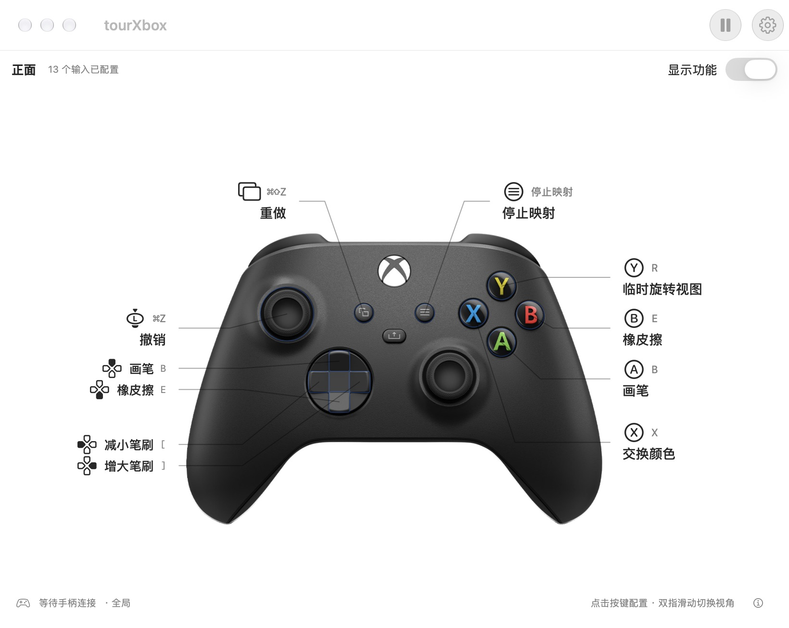
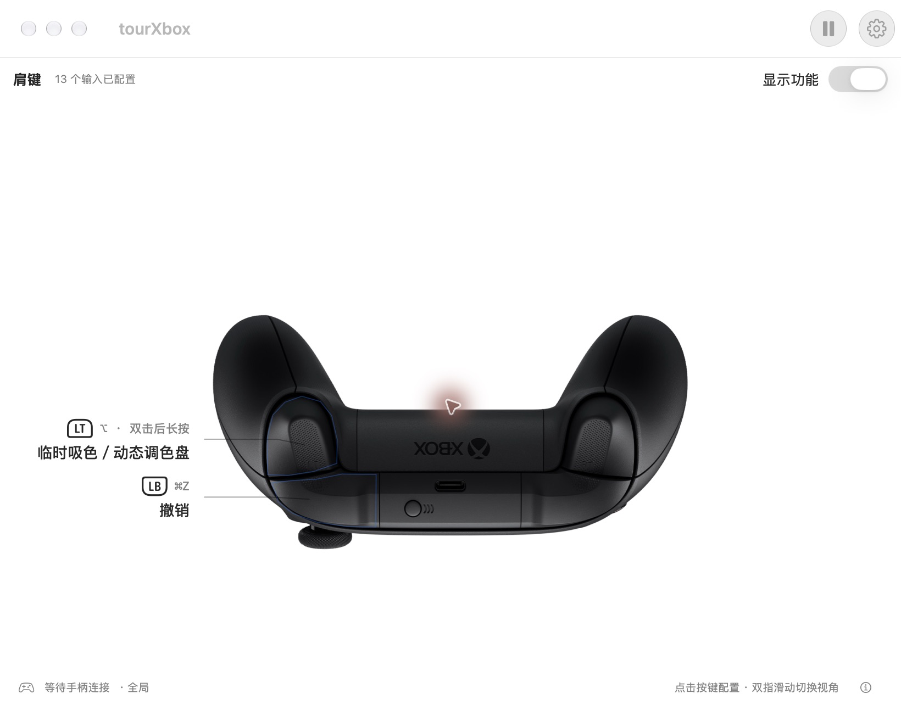
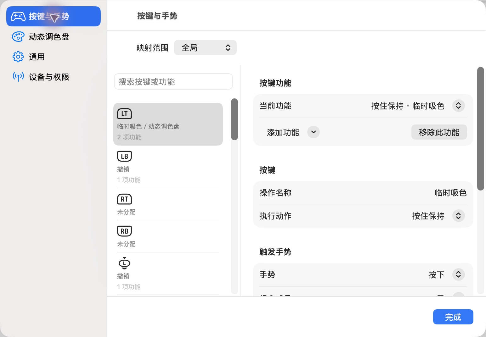
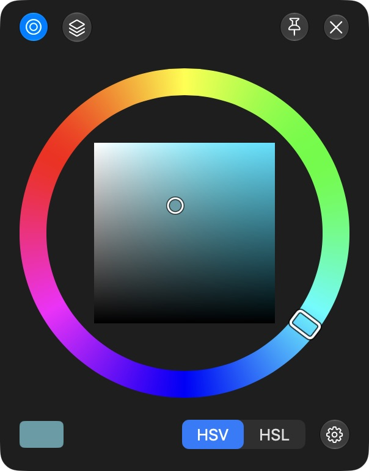
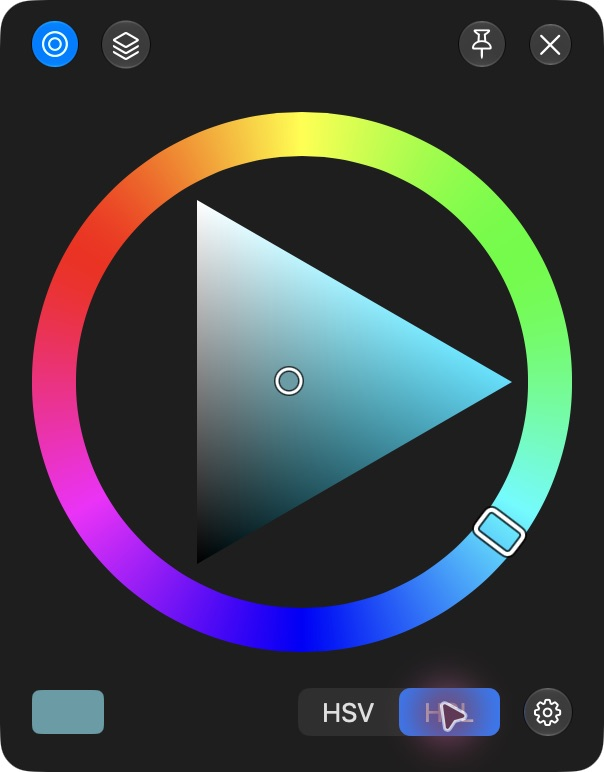
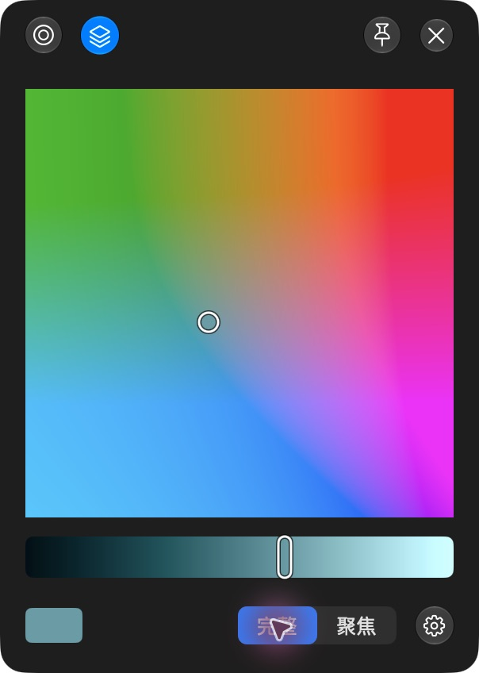
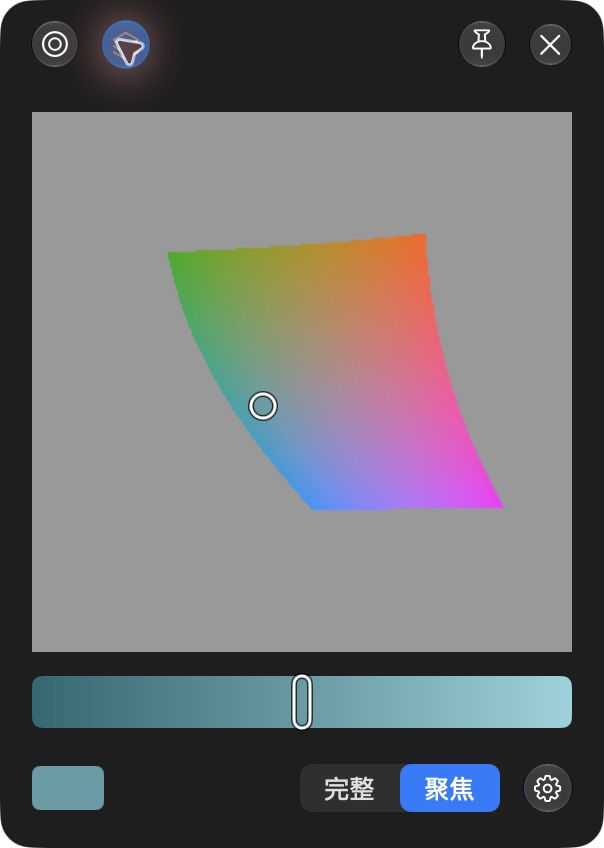
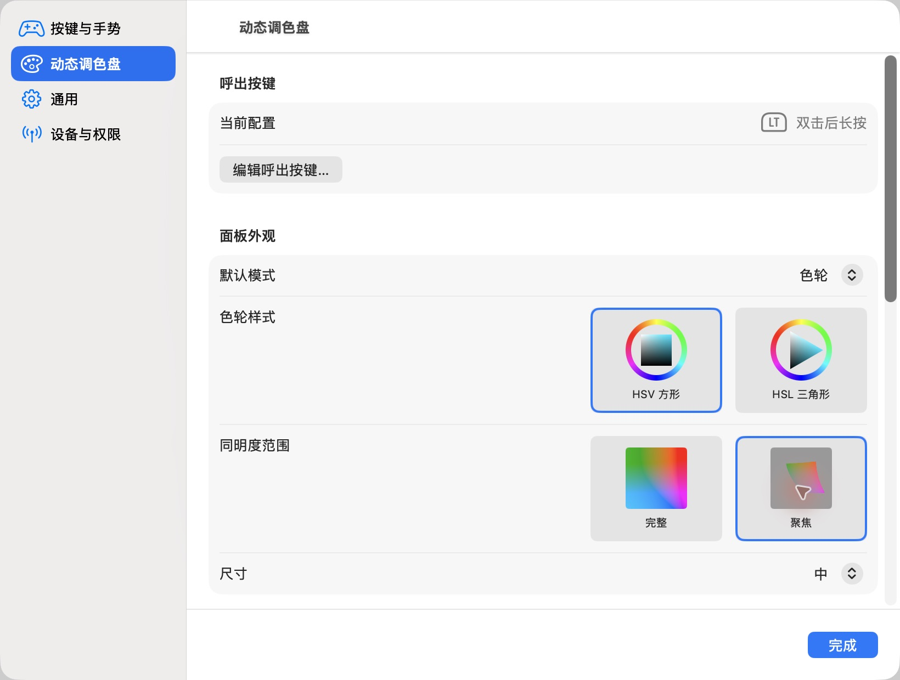

# tourXbox

### 让 Xbox 手柄成为你的绘画快捷键控制器

一手握笔，一手操作手柄。吸色、拖动画布、切换工具，再用摇杆转出下一个颜色。

**原生 macOS · 自定义快捷键 · 同键多手势 · 动态调色盘**

[**下载 macOS 预览版 ↓**](https://github.com/ZZZzcxZZZ/tourXbox/releases/tag/v0.22.1) · [更新记录](CHANGELOG.md) · [使用与兼容性](#开始使用)

Apple Silicon · v0.22.1 公开预览 · Liquid Glass 需要 macOS 26+

## 看着手柄，就能设置

点击手柄上的按键，直接编辑它的功能。打开「显示功能」，快捷键和用途就会出现在对应位置；十字键按上下、左右成对排列，每个方向都有自己的指示线。

正面与肩键视角支持整页滑动切换。按键编辑使用带箭头的小窗，设置则收在主窗口内，绘画时保持界面简洁。

> 截图为实际应用界面，展示的是自定义映射；你可以按自己的绘画习惯重新分配。

## 一个按键，不止一个功能

普通按下、按住保持、双击、双击后长按，以及多键组合，可以在同一个物理按键上分别配置。通过「当前功能」切换编辑，用「添加功能」继续扩展。

最常用的两个动作，默认放在同一个 **LT** 上：

| 操作 | 默认功能 | 使用方式 |
| --- | --- | --- |
| 按住 LT | 临时吸色 | 保持 Option，松开恢复 |
| 双击 LT，并保持第二次按下 | 动态调色盘 | 呼出面板，转动摇杆调色，松开结束 |
| 按住 LB | 拖动画布 | 保持 Space，配合数位笔拖动 |
| A / B | 画笔 / 橡皮擦 | 切换常用工具 |
| 十字键 ← / → | 减小 / 增大笔刷 | 调整笔刷大小 |

快捷键可以直接录制。保持型动作随手柄松开而释放；断连、暂停或切换作用范围时也会释放已保持的按键。同键设置了双击功能后，首次长按会等待 180 毫秒，避免吸色与调色盘同时触发。

## 在笔尖旁选色，用摇杆细调

动态调色盘在呼出时定位，选色过程中保持原位。可以放在笔尖附近，也可以用图钉固定，减少来回移动到软件侧边栏的操作。

<table>
<tr>
<td align="center" width="50%"> <b>HSV 方形</b> 色相环 + 饱和度与明度平面</td>
<td align="center" width="50%"> <b>HSL 三角形</b> 色相环 + 饱和度与亮度三角形</td>
</tr>
<tr>
<td align="center"> <b>同明度 · 完整</b> 浏览更广的颜色范围</td>
<td align="center"> <b>同明度 · 聚焦</b> 围绕原色缩小调整范围</td>
</tr>
</table>

| 手柄操作 | 调色盘内的功能 |
| --- | --- |
| 左摇杆转圈 | 调整色相或明度 |
| 右摇杆 / 十字键 ↑↓ | 横向 / 纵向微调选色位置 |
| RT | 精细调整（默认 LT 呼出配置） |
| X / Y | 切换主模式 / 子模式 |
| View / A / B | 固定 / 完成 / 关闭 |

面板还提供恢复原色、局部设置菜单和预览。预览可通过关闭按钮、Esc 或再次点击「预览调色盘」结束。

**Photoshop 连接**可读取、更新 RGB 文档的前景色。同明度模式采用 CIELAB 近似算法，尚未复现 TourBox 的私有 Luma 算法。

## 让设置适应你的工作流

- **全局或指定应用生效**：在 tourXbox 内编辑时暂停输出，切回绘画应用后生效。
- **可视化选择调色盘样式**：HSV、HSL、完整与聚焦范围都有图例；尺寸与呼出方位可调整。
- **配置导入与导出**：备份自己的映射，迁移到另一台 Mac，也可以恢复绘画默认配置。
- **数位笔兼容设置**：设备页集中显示连接、输出权限与 Wacom 修饰键兼容选项。
- **原生窗口与控件**：SwiftUI / AppKit 构建，macOS 26 上使用 Liquid Glass。

## 开始使用

1. 从 [v0.22.1 发布页](https://github.com/ZZZzcxZZZ/tourXbox/releases/tag/v0.22.1) 下载 DMG，将 tourXbox 拖入 Applications，再启动。
2. 在 macOS 蓝牙设置中连接受系统支持的 Xbox 手柄。
3. 在 tourXbox「设备与权限」中检查辅助功能／事件发送许可，启用映射。
4. 切回绘画应用，尝试 LT 长按吸色、LB 长按拖动画布。需要 Photoshop 调色时，在调色盘设置中连接宿主并允许自动化访问。

已有用户请继续使用相同的安装路径，并退出旧副本，避免授权关联到不同构建。

<b>系统要求与预览版边界</b>

- 下载包为 **Apple Silicon（arm64）**；部署目标 macOS 14，Liquid Glass 需要 macOS 26 或更高版本。其他系统版本与 Intel 硬件尚未完成本机验收。
- Xbox 型号、固件和蓝牙连接方式会影响系统可提供的输入；Guide、Share、Elite 拨片不保证在所有设备上可用。
- 当前使用临时签名，未通过 Developer ID 签名与 Apple 公证；构建更新可能需要重新确认辅助功能授权。
- Photoshop 调色连接当前支持 RGB 文档；其他宿主目前可使用快捷键映射，没有提供同等的颜色读写适配。
- 这是公开预览版。60 项自动测试已通过，仍需更多真实手柄、Wacom 持续绘画及不同系统组合的验证。详见 [验证范围](docs/TESTING.md)。
- 尚未提供 Windows 应用；核心与平台适配的划分见 [移植说明](PORTABILITY.md)。

## 开发与反馈

发现问题时，可在 [Issues](https://github.com/ZZZzcxZZZ/tourXbox/issues) 描述系统版本、手柄型号、目标应用和复现步骤。

[构建与目录说明](docs/DEVELOPMENT.md) · [验证范围](docs/TESTING.md) · [Windows 移植边界](PORTABILITY.md) · [更新记录](CHANGELOG.md)

---

控制器照片来自 Microsoft / Xbox 官方产品素材，[来源与校验值](Sources/BrushPad/Resources/SOURCES.json)。相关照片与商标归其权利人所有；本项目与 Microsoft、Xbox、TourBox 或 Adobe 无隶属或官方背书关系。
